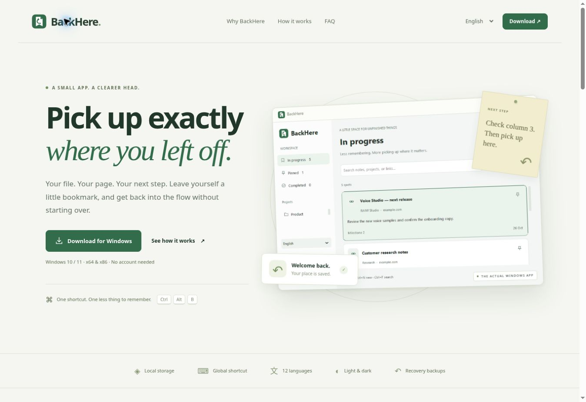

# BackHere — Windows Desktop v0.5.1

**Ажлаа яг хаана орхисноо хадгалаад дараа нь шууд үргэлжлүүл.**

Бүртгэлгүй, локал хадгалалттай Windows desktop программ. Windows 10/11 x64 болон Windows 10 x86 (32-bit)-д зориулсан тусдаа executable, суулгагчтай. x86 binary-г CI дээр 64-bit Windows-ийн WOW64 орчинд шалгана; жинхэнэ 32-bit OS дээрх QA тусдаа шаардлагатай. Windows 7/8 дэмжихгүй.

## Татах

**Нийтийн таталт:** [GitHub Releases](https://github.com/ssboroo/backhere/releases/latest). Энд суулгагч, portable ZIP, checksum, браузерын нэмэлт болон brand kit байна. Нэвтрэх шаардлагагүй.

[Actions → Windows desktop build](https://github.com/ssboroo/backhere/actions) → хамгийн сүүлийн **ногоон** run → **Artifacts**:

| Таны Windows | Artifact | Суулгагч |
| --- | --- | --- |
| 64-bit | `BackHere-Windows-x64` | `BackHere-Setup-0.5.1-x64.exe` |
| 32-bit | `BackHere-Windows-x86` | `BackHere-Setup-0.5.1-x86.exe` |

ZIP-ийг задлаад суулгагчийг ажиллуулна. Эсвэл доторх `BackHere.exe`-г шууд ажиллуулна. Python шаардахгүй. `SHA256SUMS.txt` мөн дагалдана. Суулгалт admin эрх шаардахгүй.

Windows architecture-аа **Settings → System → About → System type** дээр харна. x64, x86 хувилбар ижил өгөгдөл ашигладаг; зэрэг ажиллуулахгүй. Нэг хувилбараас нөгөөд шилжихдээ BackHere-ээс бүрэн гарч суулгана.

## Хэрэглэх

1. BackHere ажиллаж байх үед өөр программ дээр **Ctrl+Alt+B** дарна.
2. Цонхны гарчиг автоматаар орно. Хаягийг боломжтой үед авна:
   - **Explorer**: сонгосон файл эсвэл хавтас.
   - **Chrome, Edge, Firefox, Brave, Vivaldi, Opera**: UI Automation-аар харагдаж буй address талбар. Хувилбар, accessibility дэмжлэгээс хамаарна.
   - **Word**: foreground цонх COM active window-тэй таарч байвал хадгалсан документын зам, хуудас.
   - **Excel**: foreground window таарч байвал хадгалсан workbook, sheet/cell.
3. Автоматаар олдоогүй бол `…` товчоор файл сонгох эсвэл URL-ийг гараар оруулна. Clipboard-ийг унших/солихгүй.
4. Дараагийн алхмаа бичээд **Ctrl+Enter** дарна.
5. Тэмдэглэлээ сонгоод **Үргэлжлүүлэх** эсвэл давхар дарахад файл/хуудас нээгдэнэ.
6. Дуусгах/сэргээх, онцлох, хайх, засах боломжтой.

**Ctrl+N:** шинэ. **Ctrl+F:** хайлт. Хүснэгтийн гарчиг дээр дарахад шинэ/хуучнаар эрэмбэлнэ.

## Тохиргоо, tray

- **Тохиргоо → Windows асахад ажиллуулах**: зөвхөн сонгосон үед хэрэглэгчийн startup registry-д бүртгэнэ.
- **Хаахад tray хэсэгт үлдээх**: X дарахад background-д үлдэж shortcut ажиллана. Tray icon харагдаж байгаа үед л нуух тул icon алдаа гарвал үл үзэгдэх апп үүсгэхгүй.
- Tray-ийн menu → Нээх / Шинэ / Гарах. Программаас бүрэн гарахад shortcut зогсоно.
- Shortcut-оо **Ctrl/Alt/Shift + A–Z эсвэл 0–9** хослолоор өөрчилнө. Давхцал гарвал мэдэгдэнэ, өмнөх shortcut ажиллаж үлдэнэ.
- Дахин ажиллуулахад шинэ instance нээхийн оронд одоо байгаа цонхыг гаргана.

## Өгөгдөл ба сэргээх

Байршил: `%LOCALAPPDATA%\BackHere`.

- `backhere.sqlite3`: тэмдэглэл, хэл болон аппын тохиргоо.
- `backups/`: өдөр тус бүрийн SQLite snapshot; сүүлийн 7 өдрийг хадгална. Ажиллаж байх үед минут тутам тухайн өдрийн snapshot-ийг шинэчилж, гарахдаа дахин нөөцөлнө.
- **Нөөц экспортлох / импортлох**: JSON backup. Импорт одоогийн тэмдэглэлийг устгахгүй, давхардсан ID-г алгасана. Буруу нөөц бүхэлдээ цуцлагдана.
- **Тохиргоо → Өдөр тутмын нөөцөөс сэргээх**: snapshot-ийг шалгаад, баталгаажуулсны дараа одоогийн тэмдэглэлүүдийг солино. Өмнөх өгөгдлийг эхлээд `before-restore-*.json` болгон хадгална. Аппын тохиргоог хэвээр үлдээнэ.
- Нөөц гэмтсэн бол одоогийн өгөгдөл солигдохгүй.
- `backhere.log`: 500 KB × 3 хүртэлх эргэлддэг алдааны log. Дэмжлэг авахдаа алдааг тайлбарлахад ашиглана.
- Uninstall нь тэмдэглэл/нөөцийг устгахгүй; startup бүртгэлийг цэвэрлэнэ.

Өгөгдөл болон нөөц plaintext; үүлэн сервер рүү явуулахгүй. Төхөөрөмж эвдэрвэл локал snapshot хамт алдагдах тул JSON нөөцөө өөр диск дээр хадгалж болно.

## Хэл

Монгол, English, Español, Français, Deutsch, Русский, 中文, 日本語, 한국어, Português, Türkçe, العربية. Үндсэн UI, Settings болон tray menu орчуулагдсан. Windows-ийн native dialog/error болон зарим техникийн тайлбар OS/англи хэлээр байж болно. Arabic текст болон entry alignment дэмжинэ; бүрэн RTL layout хараахан биш.

## Source-оос ажиллуулах / build

Python 3.12 (Tcl/Tk болон launcher-тай):

```powershell
py -3 -m pip install -r requirements.txt
py -3 desktop\backhere.py
```

Эсвэл `Run-BackHere.bat` ажиллуулна (эхлээд requirements-ийг суулгана).

Python 3.12 x64 болон x86-г тус тус суулгасан үед:

```powershell
.\Build-Windows.ps1 -Architecture x64
.\Build-Windows.ps1 -Architecture x86
```

Сүүлийн build нь `dist\BackHere.exe`-г шинэчилнэ. Inno Setup 6 compiler:

```powershell
ISCC.exe /DTargetArch=x64 installer.iss
ISCC.exe /DTargetArch=x86 installer.iss
```

## Баталгаажуулалт

```powershell
py -3 -m unittest discover -s tests -v
py -3 tests\smoke_ui.py
```

Windows matrix pipeline дараахийг тус бүр x64/x86 дээр шалгана:

- Syntax, хадгалалт, засвар, дуусгах/сэргээх, импортын atomic validation
- SQLite WAL snapshot, эргэлт, сэргээх, гэмтсэн snapshot-ийн хамгаалалт
- Shortcut parsing, RegisterHotKey/rebind/collision/shutdown
- Pointer-size safe HWND, single-instance mutex, hidden window show event
- 12 хэлний UI, editor-оос хадгалах, хайлт, тохиргоо, real Windows tray backend
- PyInstaller EXE-ийн GUI/database self-test ба бодит 32/64-bit хэмжээ
- Суулгагч → installed EXE self-test → uninstall
- SHA256 checksum болон тусдаа downloadable artifacts

## Үлдсэн бүтээгдэхүүний ажил

v0.2 нь туршиж ашиглах desktop хувилбар. Доорхийг хийгдсэн гэж тооцохгүй:

- Автомат capture нь гуравдагч программын UI/COM-оос хамаарна. Бүх browser/Office хувилбар, олон instance, administrator цонхонд ажиллах баталгаа байхгүй; гараар оруулах боломж үлдэнэ.
- Excel cell/Word page/scroll нь хадгалсан байрлалын сануулга. Native документыг яг тэр cell/page дээр автоматаар сэргээхгүй. Веб PDF-д тоон байрлалыг `#page=N` болгох нь viewer-ээс хамаарна.
- Жинхэнэ Windows 10 32-bit төхөөрөмж, олон DPI/display, sleep/resume, antivirus болон Office/browser хувилбаруудын бодит QA.
- Publisher code signing, auto-update, лиценз/төлбөр, орчуулгын native speaker review.
- Суулгагч болон EXE unsigned; SmartScreen анхааруулга гарч болно. Танихгүй нийтлэгчийн анхааруулгыг автоматаар тойрохгүй.

Нэг удаагийн $15–25 борлуулалтад гаргахын өмнө эдгээр үлдсэн шалгалт, signing, лицензийг гүйцээнэ.

## v0.3 — шинэ desktop UI

- Нэгдсэн design tokens: 4/8 px зай хэмжээ, нэг төрлийн line icon, уншихад хялбар typography.
- Theme-aware **Light / Dark / System**. Сонголтыг дараа нээхэд санана.
- Тэмдэглэлийн card жагсаалт + сонгосон ажлын **дараагийн алхам** inspector.
- Нарийн цонхонд inspector нь тусдаа dialog болж нээгдэнэ.
- Төслөөр шүүх, хайлт/хоосон төлөв, шууд үйлдлийн товчлуурууд.
- Keyboard focus border, Tab / Enter / Space; Ctrl+N, Ctrl+F, Ctrl+Enter.
- Editor-ийн алдааг оруулсан талбартай нь хамт харуулна.
- Settings, тэмдэглэл нэмэх dialog, tray болон 12 хэл нэг UI хэв маягтай.
- Өмнөх SQLite өгөгдөл, backup, capture болон x64/x86 дэмжлэг хэвээр.

UI screenshots: ногоон Actions run-ийн **BackHere-UI-x64 / x86** artifact. Зураг дахь жишээнүүд нь зөвхөн CI-ийн тусгаарласан туршилтын өгөгдөл; хэрэглэгчийн программд автоматаар нэмэгдэхгүй.

Шалгалт: хоёр theme-ийн үндсэн текст/button contrast ≥4.5:1, 12 хэлээр UI нээх, theme солих, нарийн/өргөн layout, dialog-оос хадгалах, packaged EXE/installer. Энэ нь бүрэн accessibility certification биш; NVDA/JAWS болон high-contrast Windows горимын хараат бус аудит үлдэнэ.

## Олон нийтэд нээлттэй бүтээгдэхүүний сайт

**https://backhere-rainy.ssboroostore.chatgpt.site/**

- Монгол / Англи танилцуулга, бодит аппын зураг, theme preview, FAQ, privacy.
- Нийтийн GitHub Release v0.5.1-оос x64/x86 суулгагч, portable ZIP, SHA256 болон brand kit татна.
- Вебийн 375 px болон desktop layout, хэл солих, зураг ачаалах болон checksum таталтыг браузераар шалгасан.
- Windows release workflow: `40348892332`, хоёр архитектур болон release publication амжилттай.
- Том EXE/ZIP таталтын browser completion event-ийг cloud browser-оос баталгаажуулж чадаагүй. Файлуудын release metadata, checksum болон Windows install/run/uninstall CI шалгалт баталгаажсан.
- Publisher signing, автомат binary updater, төлбөр/лицензийн систем одоогоор байхгүй; жинхэнэ 32-bit төхөөрөмжийн тусдаа QA үлдэнэ.



## Workspace sessions (0.5.1)

Open **Workspaces**, name your current work, and select **Save current workspace**. Review the captured windows before restoring. Choose individual windows and inspect the result log. Optional auto-save runs every five minutes while BackHere is running and retains the latest 20 automatic snapshots. It is disabled by default.

Capture includes top-level application windows and monitor-aware layout; Explorer folders and saved Word/Excel documents where available; visible browser URLs where accessible. A closed app reopens from its executable without replaying arbitrary command lines. Unsupported/packaged/privileged apps may need manual reopening. Existing matching windows keep their present document/tab content. Repeated browser restoration can create duplicate tabs/windows.

For complete browser tab lists, download **BackHere-Browser-Companion-0.5.1.zip** from Releases and follow its README. Export your tabs locally, capture that browser in a desktop workspace, then select **Import browser tabs**. The companion can also restore its JSON directly, including pinned/active flags. Private/internal pages, form data and history are excluded. Up to 64 browser windows and 200 tabs per window are supported.

**Workspace snapshots are not process-memory snapshots.** They cannot recover arbitrary unsaved app data, exact cursor/cell positions, terminal processes, browser forms, or internal app state. Use the separately confirmed **Hibernate Windows** action to continue the current Windows memory session when Windows supports it; this powers down the computer. Hibernate cannot provide independently selectable historical RAM sessions. BackHere never closes existing apps or forces documents to save.

Workspace snapshots/backups contain plain-text application paths, document names and URLs. JSON imports strip machine-specific window identities. New workspace UI explanations support Mongolian/English; the other existing locales currently fall back to English for this feature.
